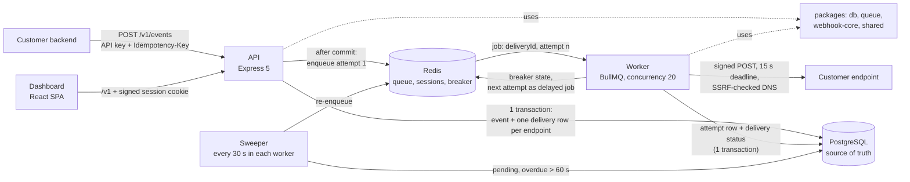
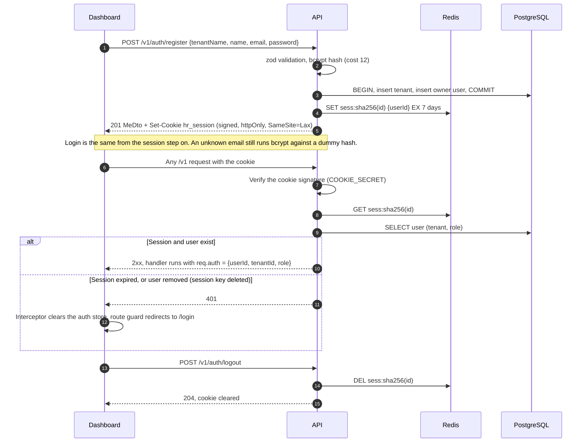
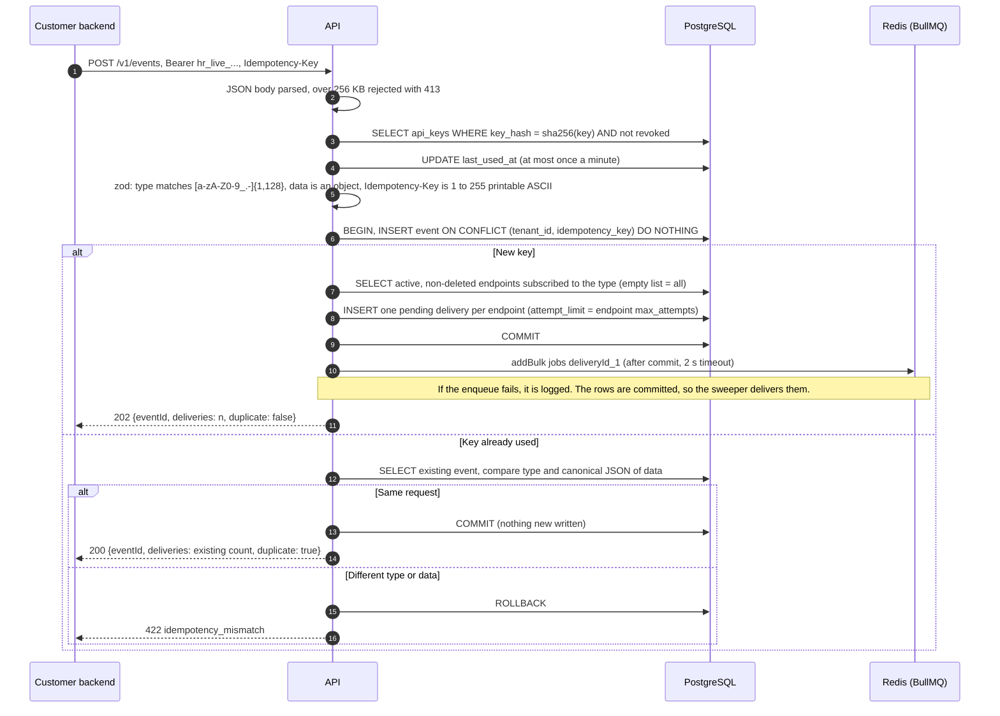
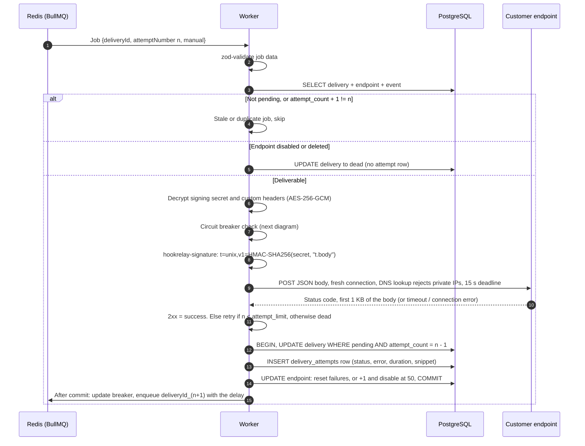
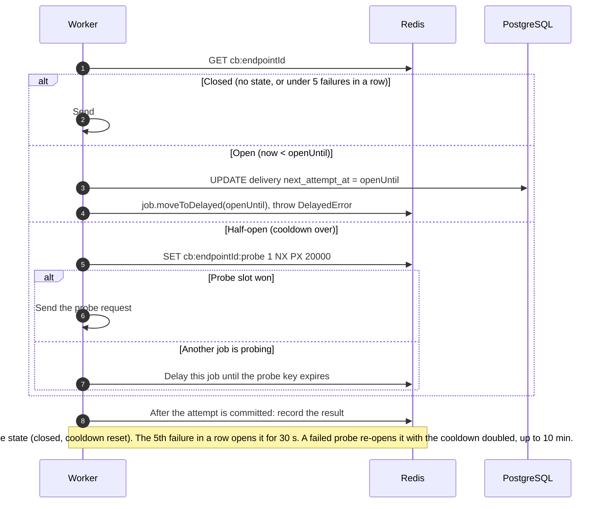
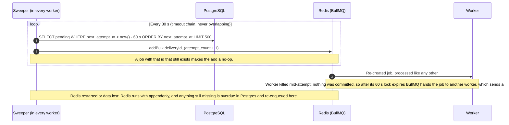
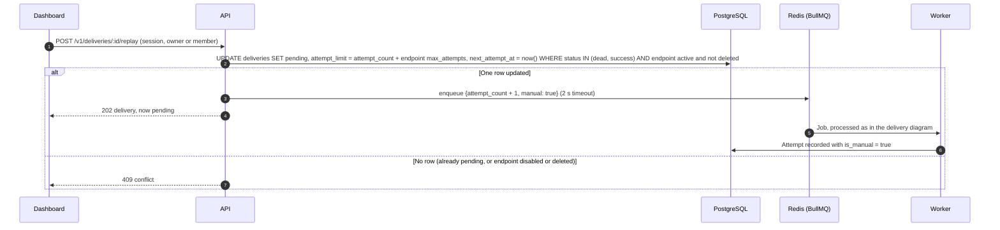

# Hookrelay

A self-hostable webhook delivery service: your backend sends an event once to `POST /v1/events`, and Hookrelay
durably stores it and delivers an HMAC-signed copy to every subscribed endpoint, retrying with backoff until it
succeeds or runs out of attempts, with every attempt visible in a dashboard.

<p>
  
</p>

Also: Drizzle ORM, BullMQ, Zod, Turborepo, shadcn/ui on Base UI, pino, k6.

**What it does**

- **Ingest** with API keys and `Idempotency-Key`; one event fans out to every matching endpoint in a single transaction.
- **Delivery** with HMAC-SHA256 signatures, a 15 s deadline, no redirects and an SSRF check at save time and again
  at connect time.
- **Failure handling:** exponential backoff with jitter, `Retry-After`, a per-endpoint circuit breaker, auto-disable
  of dead endpoints, dead-lettering and manual replay.
- **Recovery:** Postgres is the source of truth (outbox pattern); a sweeper re-enqueues anything Redis or a crashed
  worker lost.
- **Multi-tenant dashboard:** endpoints, events, an attempt-by-attempt delivery timeline, API keys and a 3-seat team
  with owner and member roles.

**Measured on one laptop** (production build, one API and one worker process; [details](#results)): ingest sustained
250 events/s for 60 s at p95 85 ms with 0 errors (k6, constant arrival rate); at light load a webhook reached its
receiver p50 27 ms after the API call; force-killing the worker during ingest and restarting Redis during delivery
lost 0 of 5,000 events.

## Architecture



| Component                        | Responsibility                                                                                                                                                                 |
| -------------------------------- | ------------------------------------------------------------------------------------------------------------------------------------------------------------------------------ |
| `apps/api`                       | Express 5 REST API (route → controller → service). Session auth for the dashboard, API-key auth for ingest, zod validation of every input, `{ data }` / `{ error }` responses. |
| `apps/worker`                    | BullMQ worker: one job = one delivery attempt. Signs and sends, records the outcome, schedules the next attempt, runs the circuit breaker and the outbox sweeper.              |
| `apps/dashboard`                 | React 19 + Vite SPA (shadcn/ui on Base UI, Tailwind 4, zustand for auth only, axios + a `useRequest` hook).                                                                    |
| `apps/demo-receiver`             | A deliberately misbehaving receiver (`/ok`, `/flaky`, `/slow`, `/down`, `/ratelimited`, `/verify/:name`) for the demo and load tests.                                          |
| `packages/webhook-core`          | Pure, unit-tested logic: signing and verification, backoff, `Retry-After`, SSRF checks, breaker state machine, AES-GCM, canonical JSON.                                        |
| `packages/db`, `queue`, `shared` | Drizzle schema and migrations; BullMQ queue, job schema and deterministic job ids; DTO types and constants.                                                                    |

**Postgres is the source of truth; Redis is only the fast path (outbox pattern).** Ingest writes the event and its
`deliveries` rows in one transaction and enqueues jobs only after commit. Every attempt and its outcome is recorded
in Postgres; BullMQ runs with `attempts: 1` and holds nothing that cannot be rebuilt. If an enqueue fails, a worker
dies, or Redis loses data, the sweeper finds `pending` deliveries whose `next_attempt_at` is more than 60 s overdue
and enqueues them again. Job ids are deterministic (`<deliveryId>_<attempt>`), so re-adding a job that still exists
is a no-op. A failure can delay a delivery, never lose it.

## Key workflows

### Registration, login and sessions

Sessions live only in Redis; the cookie carries a random id, and the user row is reloaded on every request, so a
removed member is logged out immediately and a role is never stale.



### Event ingestion and fan-out



### Delivery, signing and retries



The retry delay is equal-jitter exponential backoff, `base = min(30 s × 4^(n-1), 6 h)` and
`delay = base/2 + random(0, base/2)`: bases of 30 s, 2 min, 8 min, 32 min, ~2 h, then 6 h, each delay falling
between half and all of its base. A 429 or 503 with a valid
`Retry-After` uses that value instead, clamped to 1 s .. 6 h. The conditional `UPDATE` is the concurrency guard: a
duplicate or stale job that reaches the transaction matches no row and records nothing.

### Circuit breaker

Short-term protection per endpoint, kept in Redis (`cb:<endpointId>`, TTL 1 day). Parking a job is not an attempt.



Long-term protection is separate and lives in Postgres: 50 failed attempts in a row across all of an endpoint's
deliveries set it to `disabled`. Its pending deliveries become `dead` when their next job runs; re-enabling resets
the counter and the breaker, and dead deliveries can then be replayed.

### Outbox sweeper and recovery



A breaker-parked job moves `next_attempt_at` forward, so the sweeper does not mistake it for a lost one. Errors
before sending (Postgres down, decryption failure) fail the job without using an attempt; the sweeper retries it.

### Manual replay



A single conditional `UPDATE` makes a double click (or two users) replay once. The replay gets a fresh retry budget
without rewriting history: attempt numbers keep counting up.

## Design decisions and trade-offs

| Decision                                                                    | Why                                                                                                                | Trade-off                                                                                                                      |
| --------------------------------------------------------------------------- | ------------------------------------------------------------------------------------------------------------------ | ------------------------------------------------------------------------------------------------------------------------------ |
| Outbox in Postgres; BullMQ `attempts: 1`, retries planned by the worker     | One durable record of every attempt; Redis can be lost without losing work                                         | A lost job waits up to ~90 s (60 s grace + 30 s interval) for the sweeper                                                      |
| At-least-once delivery                                                      | A worker that dies after sending but before committing must not lose the event                                     | Receivers dedupe on `hookrelay-event-id`; the chaos test produced 10 duplicates in 5,000                                       |
| Conditional `UPDATE ... WHERE status = 'pending' AND attempt_count = n - 1` | Makes duplicate and stale jobs harmless without distributed locks                                                  | A duplicate job may still send once before losing the race                                                                     |
| Breaker in Redis (minutes) + auto-disable in Postgres (permanent)           | Pause a struggling endpoint cheaply; stop a dead one for good                                                      | Breaker updates are read-modify-write without a lock, so a concurrent failure can be lost; acceptable for a best-effort signal |
| `node:http` with a custom DNS `lookup`, not `fetch`                         | The address that is checked is the address connected to (defeats DNS rebinding); no redirects; no extra dependency | Each attempt opens a fresh connection (`agent: false`)                                                                         |
| Sessions in Redis + signed cookie, user reloaded per request                | Instant revocation on member removal; no session table                                                             | One Redis and one Postgres read per dashboard request                                                                          |
| `SameSite=Lax` cookie + CORS limited to `DASHBOARD_URL`                     | CSRF protection without tokens                                                                                     | The dashboard must be served same-site with the API (Vite proxies `/v1` in development)                                        |
| No ordering guarantee                                                       | Concurrent workers and independent retries                                                                         | Receivers must not depend on arrival order                                                                                     |
| Lists return the newest rows with `?limit` (≤ 100), no pagination           | Scope: the dashboard shows the latest 50                                                                           | Older history is not browsable in the UI                                                                                       |

## Delivery guarantees

| Property           | Behaviour                                                                                                                                                                                                                                                                              |
| ------------------ | -------------------------------------------------------------------------------------------------------------------------------------------------------------------------------------------------------------------------------------------------------------------------------------- |
| Delivery           | **At-least-once.** A worker that dies after sending but before committing causes a resend. Receivers dedupe on `hookrelay-event-id`.                                                                                                                                                   |
| Durability         | `202` is returned only after the event and its deliveries are committed to Postgres.                                                                                                                                                                                                   |
| Ordering           | Not guaranteed (concurrent workers, independent retries).                                                                                                                                                                                                                              |
| Ingest idempotency | Same `Idempotency-Key` and same type and data (key order ignored): `200` with the original event and no new deliveries. Same key, different request: `422`. Without the header, a random key is used.                                                                                  |
| Success            | HTTP 2xx only. 3xx (redirects are not followed), 4xx, 5xx, timeouts, connection errors and blocked addresses are failures.                                                                                                                                                             |
| Retries            | Backoff as above, `Retry-After` for 429/503. Default 8 attempts per delivery (1 to 20 per endpoint, copied onto the delivery at creation), then `dead`.                                                                                                                                |
| Circuit breaker    | Per endpoint: 5 failures in a row open it for 30 s, doubling up to 10 min; one probe decides. Parked jobs do not use attempts.                                                                                                                                                         |
| Auto-disable       | 50 failed attempts in a row disable the endpoint; its pending deliveries become `dead` when their next job runs.                                                                                                                                                                       |
| Replay             | A `dead` or `success` delivery of an active endpoint can be replayed with a fresh retry budget; a double click replays once.                                                                                                                                                           |
| Signing            | `hookrelay-signature: t=<unix>,v1=<hex HMAC-SHA256(secret, "<t>.<raw body>")>`. Rotation replaces the secret immediately (no overlap).                                                                                                                                                 |
| SSRF               | Endpoint URLs must be `https` and contain no credentials. Loopback, RFC 1918, link-local (incl. `169.254.169.254`), CGNAT, unique-local and unspecified addresses are rejected when saving **and** in the worker's DNS lookup at connect time; IP-literal URLs are checked separately. |
| Secrets at rest    | Signing secrets and custom headers: AES-256-GCM. API keys, invitation tokens and session ids (Redis keys): SHA-256. Passwords: bcrypt, cost 12.                                                                                                                                        |

## Results

Setup: Intel i5-1240P, 16 GB RAM, Windows 11, Postgres 18 and Redis 8 in Docker Desktop. One API process and one
worker process (concurrency 20), production bundles (`node dist/index.js`), `LOG_LEVEL=warn`, default Postgres pool
(10 connections). k6, the demo receiver and the databases ran on the same laptop and competed with the API for
CPU, so these are single-machine numbers, not a production capacity figure. The apps ran with
`NODE_ENV=development`: its only effect is that the session cookie is not marked `Secure`, which k6's cookie jar
needs over plain-HTTP localhost; the code is the same production bundle.

### Ingest benchmark (k6, constant arrival rate, 60 s per run)

k6 sends at a fixed rate regardless of how fast the server answers, so a slow server cannot hide its tail latency.

| Target rate   | Achieved        | p50       | p95       | p99        | Errors | Thresholds      |
| ------------- | --------------- | --------- | --------- | ---------- | ------ | --------------- |
| 200 req/s     | 198.9 req/s     | 25 ms     | 53 ms     | 108 ms     | 0      | pass            |
| **250 req/s** | **248.9 req/s** | **27 ms** | **85 ms** | **112 ms** | **0**  | **pass**        |
| 300 req/s     | 266.2 req/s     | 1.09 s    | 1.20 s    | 1.26 s     | 0      | fail: saturated |
| 600 req/s     | 278.0 req/s     | 1.10 s    | 1.23 s    | 1.27 s     | 0      | fail: saturated |

Thresholds: errors < 0.1%, p95 < 200 ms, p99 < 400 ms, no dropped iterations. A ramp from 50 to 800 req/s sent
38,121 requests with **0 failures** (all 202): past its ceiling of about 270 req/s the API slows down (queueing)
instead of returning errors. All 114,185 events from these runs were delivered; none ended `dead` or `pending`.

### End-to-end delivery latency

`pnpm load-test --events=2000 --concurrency=<5|50>` measures from the API request to the webhook arriving at the
receiver. It is a closed loop (each in-flight request waits for its reply), so these are short bursts, not
sustained rates; the k6 table above is the throughput benchmark.

| Load                                                       | End-to-end p50 | p95    | p99    | Delivered | Duplicates |
| ---------------------------------------------------------- | -------------- | ------ | ------ | --------- | ---------- |
| Light: 5 requests in flight (7 s burst, ~280 req/s)        | 27 ms          | 65 ms  | 84 ms  | 2000/2000 | 0          |
| Heavy: 50 in flight (6.5 s burst, ~310 req/s; queue grows) | 1.09 s         | 2.06 s | 2.10 s | 2000/2000 | 0          |

### Chaos test

`pnpm load-test --events=5000 --concurrency=50`, production build:

1. 6 s into ingest the worker was force-killed (`TerminateProcess`, the Windows equivalent of `kill -9`).
2. 10 s later a new worker was started.
3. `docker compose restart redis` while the backlog was being delivered.

| Check                            | Result                                                                                                                                                                        |
| -------------------------------- | ----------------------------------------------------------------------------------------------------------------------------------------------------------------------------- |
| Ingest while the worker was dead | 5000 × 202, 0 failed requests                                                                                                                                                 |
| Events delivered                 | **5000 / 5000**, 0 still `pending`                                                                                                                                            |
| Postgres                         | 5000 deliveries `success`, exactly 1 recorded attempt each                                                                                                                    |
| Duplicate arrivals               | 10: requests the killed worker sent but never committed; after its 60 s job lock expired, BullMQ gave them to the new worker (at-least-once, deduped by `hookrelay-event-id`) |
| Slowest delivery                 | 72 s (the 60 s lock of the killed worker's in-flight jobs)                                                                                                                    |

A dev-mode run of the same test gave the same outcome (5000/5000, 13 duplicates, 0 pending).

### Unit tests

`pnpm test` runs 85 Vitest tests in 8 files: signing and verification, backoff and `Retry-After` parsing, SSRF and
IP checks, the breaker state machine, AES-GCM and canonical JSON (`packages/webhook-core`, 63), plus the retry
policy and the HTTP client against a local server: timeouts, no redirects, 1 KB response cap and private-address
blocking (`apps/worker`, 22). There are no API integration tests; `pnpm demo` is the end-to-end check.

## Running locally

Requirements: Node.js ≥ 24, pnpm 11, Docker. [k6](https://k6.io) only for the benchmark.

```sh
cp .env.example .env        # fill ENCRYPTION_KEY and COOKIE_SECRET (see below)
docker compose up -d        # Postgres 18 + Redis 8 (appendonly, noeviction)
pnpm install
pnpm db:migrate
pnpm dev                    # api :3000, worker, demo receiver :4000, dashboard :5173
```

In a second terminal:

```sh
pnpm demo                   # tenant, API key, one endpoint per demo route, events; prints a login and what to watch
pnpm test                   # unit tests
pnpm load-test              # end-to-end verifier: --events=1000 --concurrency=20 by default; exits 1 on any loss
pnpm load-test:k6           # k6 benchmark: 200 req/s for 60 s (-e RATE=250, -e PROFILE=stress)
```

Open http://localhost:5173 and log in with the account `pnpm demo` prints. The demo receiver misbehaves on purpose:
`/flaky` returns 500 half the time, `/slow` answers after 20 s (past the timeout), `/down` returns 503,
`/ratelimited` returns 429 with `Retry-After: 30`, and `/verify/:name` checks the signature. That exercises retries,
the breaker, dead-lettering and replay. `pnpm demo` also checks idempotency (repeat key → 200, changed body → 422).

For benchmark numbers use the production build: `pnpm build`, then `node --env-file=.env apps/<app>/dist/index.js`
for the API, the worker and the demo receiver.

### Configuration

One `.env` at the repository root; each app validates its variables with zod at startup and exits with a clear
message if one is missing or malformed.

| Variable                                                | Used by                  | Default / notes                                                                                                                 |
| ------------------------------------------------------- | ------------------------ | ------------------------------------------------------------------------------------------------------------------------------- |
| `DATABASE_URL`, `REDIS_URL`                             | api, worker, drizzle-kit | Match `docker-compose.yml` in `.env.example`                                                                                    |
| `ENCRYPTION_KEY`                                        | api, worker              | 32 bytes, base64: `openssl rand -base64 32`                                                                                     |
| `COOKIE_SECRET`                                         | api                      | At least 32 characters: `openssl rand -base64 48`                                                                               |
| `PORT`                                                  | api                      | `3000`                                                                                                                          |
| `DASHBOARD_URL`                                         | api                      | CORS origin and invitation-link base, e.g. `http://localhost:5173`                                                              |
| `ALLOW_HTTP_DESTINATIONS`, `ALLOW_PRIVATE_DESTINATIONS` | api, worker              | `false`. `.env.example` sets both to `true` so endpoints can target the demo receiver on localhost; keep them off in production |
| `WORKER_CONCURRENCY`                                    | worker                   | `20`                                                                                                                            |
| `NODE_ENV`, `LOG_LEVEL`                                 | api, worker              | `development` / `info`; `production` marks the session cookie `Secure`                                                          |
| `DEMO_PORT`                                             | demo receiver            | `4000`                                                                                                                          |

## API

Base path `/v1`. Success bodies are `{ "data": ... }`, errors `{ "error": { "code", "message", "details?", "requestId" } }`;
logout and every `DELETE` return `204`. `POST /v1/events` authenticates with an API key; register, login and
invitation accept need no credentials; every other `/v1` route uses the dashboard session.

| Area                 | Routes                                                                                                                                       |
| -------------------- | -------------------------------------------------------------------------------------------------------------------------------------------- |
| Auth                 | `POST /auth/register`, `POST /auth/login`, `POST /auth/logout`, `GET /auth/me`, `POST /invitations/accept`                                   |
| Team (owner manages) | `GET /team/users`, `DELETE /team/users/:id` (owner removes, member leaves), `GET` / `POST /team/invitations`, `DELETE /team/invitations/:id` |
| API keys             | `GET /api-keys`; owner only: `POST /api-keys` (key shown once), `DELETE /api-keys/:id`                                                       |
| Endpoints            | `GET` / `POST /endpoints`, `GET` / `PATCH` / `DELETE /endpoints/:id`, `POST /endpoints/:id/rotate-secret`, `POST /endpoints/:id/test`        |
| Events               | `POST /events` (API key), `GET /events?type=&limit=`, `GET /events/:id` (payload and deliveries)                                             |
| Deliveries           | `GET /deliveries?status=&endpointId=&eventId=&limit=`, `GET /deliveries/:id` (attempts and event), `POST /deliveries/:id/replay`             |
| Stats                | `GET /stats` (last 24 h counts by status and success rate)                                                                                   |
| Probes               | `GET /healthz`, `GET /readyz` (checks Postgres and Redis); not under `/v1`, plain `{ "status" }` body                                        |

### Send an event

```sh
curl -X POST http://localhost:3000/v1/events \
  -H "Authorization: Bearer hr_live_..." \
  -H "Idempotency-Key: order-1001" \
  -H "Content-Type: application/json" \
  -d '{"type":"order.created","data":{"orderId":1001,"amount":4999}}'
# 202 {"data":{"eventId":"...","deliveries":2,"duplicate":false}}
```

### Receive and verify a webhook

Each endpoint receives `POST` with body `{"id","type","createdAt","data"}` and the headers `hookrelay-event-id`,
`hookrelay-event-type`, `hookrelay-delivery-id`, `hookrelay-attempt`, `hookrelay-signature`, plus any custom headers
configured on the endpoint. Verify the signature against the **raw** body:

```js
import { createHmac, timingSafeEqual } from "node:crypto";

export function verify(secret, header, rawBody, toleranceSec = 300) {
  const parts = Object.fromEntries(
    header.split(",").map((part) => part.split("=", 2)),
  );
  const t = Number(parts.t);
  if (!Number.isInteger(t) || Math.abs(Date.now() / 1000 - t) > toleranceSec)
    return false;
  const expected = Buffer.from(
    createHmac("sha256", secret).update(`${t}.${rawBody}`).digest("hex"),
  );
  const given = Buffer.from(parts.v1 ?? "");
  return given.length === expected.length && timingSafeEqual(given, expected);
}
```

Then answer 2xx quickly and dedupe on `hookrelay-event-id`.

## Repository layout

```
apps/api               Express API: auth, team, API keys, endpoints, ingest, deliveries, replay, stats
apps/worker            BullMQ worker: signed delivery, retry policy, circuit breaker, outbox sweeper
apps/dashboard         React dashboard
apps/demo-receiver     misbehaving receiver for demos and load tests
packages/webhook-core  pure, unit-tested logic: signing, backoff, SSRF checks, breaker, crypto
packages/db            Drizzle schema and SQL migrations (8 tables, no session table)
packages/queue         BullMQ queue, job schema, deterministic job ids
packages/shared        DTO types and constants
scripts/               demo.ts, load-test.ts (end-to-end verifier), load-test.k6.js (benchmark)
```

Dependencies only point inward: apps use packages, packages use no internal package, apps never import each other,
and the dashboard imports `@hookrelay/shared` for types only.

## Limitations

- No rate limiting on login or ingest, and no per-endpoint concurrency limit.
- No Dockerfiles or deployment configuration: Docker Compose runs only Postgres and Redis. In production the
  dashboard must be served from the same site as the API for the `SameSite=Lax` session cookie.
- No pagination or retention: lists show the newest rows (`?limit`, max 100) and history is never deleted.
- Invitations are links the owner copies; no email is sent.
