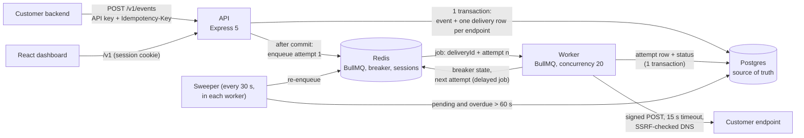

# Hookrelay

A self-hostable webhook delivery service. A backend sends one event to `POST /v1/events`; Hookrelay stores it and
delivers it to every subscribed endpoint with HMAC signatures, retries with exponential backoff and jitter, a
per-endpoint circuit breaker, dead-lettering and manual replay. A React dashboard shows every attempt.

**Measured on one laptop** (production build, one API and one worker process; [details](#results)): ingest sustained
250 events/s for 60 s at p95 85 ms with 0 errors (k6, constant arrival rate); at light load a webhook reached its
receiver p50 27 ms after the API call; force-killing the worker during ingest and restarting Redis during delivery
lost 0 of 5,000 events.

## Architecture



**Postgres is the source of truth; Redis is only the fast path (outbox pattern).** Ingest writes the event and its
`deliveries` rows in one transaction and only then enqueues jobs. Every attempt and its outcome is recorded in
Postgres; BullMQ runs with `attempts: 1` and holds no state we cannot rebuild. If an enqueue fails, the worker
crashes, or Redis loses data, the sweeper finds `pending` deliveries whose `next_attempt_at` is more than 60 s
overdue and enqueues them again. Job ids are deterministic (`<deliveryId>_<attempt>`), so re-adding a job that
still exists is a no-op. A failure can delay a delivery, never lose it.

## Delivery guarantees

| Property           | Behaviour                                                                                                                                                                                                                                                              |
| ------------------ | ---------------------------------------------------------------------------------------------------------------------------------------------------------------------------------------------------------------------------------------------------------------------- |
| Delivery           | **At-least-once.** A worker that dies after sending but before committing causes a resend. Receivers dedupe on `hookrelay-event-id`.                                                                                                                                   |
| Durability         | An event is accepted (202) only after it and its deliveries are committed to Postgres.                                                                                                                                                                                 |
| Ordering           | Not guaranteed (concurrent workers, independent retries).                                                                                                                                                                                                              |
| Ingest idempotency | Same `Idempotency-Key` and body: 200 with the original event, no new deliveries. Same key, different body: 422.                                                                                                                                                        |
| Success            | HTTP 2xx only. 3xx (redirects are not followed), 4xx, 5xx, timeouts and connection errors are failures.                                                                                                                                                                |
| Retries            | Exponential backoff with equal jitter: base 30 s × 4ⁿ, capped at 6 h. `Retry-After` is honoured for 429/503 (clamped to 1 s .. 6 h). Default 8 attempts per delivery (1..20), then `dead`.                                                                             |
| Circuit breaker    | Per endpoint, in Redis: 5 failures in a row open it for 30 s, doubling up to 10 min; then one probe request decides. Parked jobs do not use attempts.                                                                                                                  |
| Auto-disable       | 50 failed attempts in a row across deliveries disable the endpoint; its pending deliveries become `dead`.                                                                                                                                                              |
| Replay             | A `dead` or `success` delivery can be replayed with a fresh retry budget; a double click replays once.                                                                                                                                                                 |
| Signing            | `hookrelay-signature: t=<unix>,v1=<HMAC-SHA256(secret, "<t>.<raw body>")>`; receivers reject timestamps older than 5 min.                                                                                                                                              |
| SSRF               | Endpoint URLs must be `https` without credentials; private, loopback, link-local (incl. `169.254.169.254`), CGNAT and unique-local addresses are rejected when saving **and** again in the worker's DNS lookup at send time, so DNS rebinding cannot bypass the check. |
| Secrets at rest    | Signing secrets and custom headers: AES-256-GCM. API keys and invitation tokens: SHA-256. Passwords: bcrypt (cost 12).                                                                                                                                                 |

## Results

Setup: Intel i5-1240P, 16 GB RAM, Windows 11, Postgres 18 and Redis 8 in Docker Desktop. One API process and one
worker process (concurrency 20), production bundles (`node dist/index.js`), `LOG_LEVEL=warn`, default Postgres pool
(10 connections). k6, the demo receiver and the databases ran on the same laptop and competed with the API for
CPU, so these are single-machine numbers, not a production capacity figure. The apps ran with
`NODE_ENV=development`: its only effect is that the session cookie is not marked `Secure`, which k6's cookie jar
needs over plain-HTTP localhost; the code is the same production bundle.

### Ingest benchmark (k6, constant arrival rate, 60 s per run)

k6 sends at a fixed rate regardless of how fast the server answers, so a slow server cannot hide its tail latency.

| Target rate   | Achieved        | p50       | p95       | p99        | Errors | Thresholds      |
| ------------- | --------------- | --------- | --------- | ---------- | ------ | --------------- |
| 200 req/s     | 198.9 req/s     | 25 ms     | 53 ms     | 108 ms     | 0      | pass            |
| **250 req/s** | **248.9 req/s** | **27 ms** | **85 ms** | **112 ms** | **0**  | **pass**        |
| 300 req/s     | 266.2 req/s     | 1.09 s    | 1.20 s    | 1.26 s     | 0      | fail: saturated |
| 600 req/s     | 278.0 req/s     | 1.10 s    | 1.23 s    | 1.27 s     | 0      | fail: saturated |

Thresholds: errors < 0.1%, p95 < 200 ms, p99 < 400 ms, no dropped iterations. A ramp from 50 to 800 req/s sent
38,121 requests with **0 failures** (all 202): past its ceiling of about 270 req/s the API slows down (queueing)
instead of returning errors. All 114,185 events from these runs were delivered; none ended `dead` or `pending`.

### End-to-end delivery latency

`pnpm load-test` measures from the API request to the webhook arriving at the receiver (2,000 events). It is a
closed loop (each in-flight request waits for its reply), so these are short bursts, not sustained rates; the k6
table above is the throughput benchmark.

| Load                                                       | End-to-end p50 | p95    | p99    | Delivered | Duplicates |
| ---------------------------------------------------------- | -------------- | ------ | ------ | --------- | ---------- |
| Light: 5 requests in flight (7 s burst, ~280 req/s)        | 27 ms          | 65 ms  | 84 ms  | 2000/2000 | 0          |
| Heavy: 50 in flight (6.5 s burst, ~310 req/s; queue grows) | 1.09 s         | 2.06 s | 2.10 s | 2000/2000 | 0          |

### Chaos test

`pnpm load-test --events=5000 --concurrency=50`, production build:

1. 6 s into ingest the worker was force-killed (`TerminateProcess`, the Windows equivalent of `kill -9`).
2. 10 s later a new worker was started.
3. `docker compose restart redis` while the backlog was being delivered.

| Check                            | Result                                                                                                                                                                        |
| -------------------------------- | ----------------------------------------------------------------------------------------------------------------------------------------------------------------------------- |
| Ingest while the worker was dead | 5000 × 202, 0 failed requests                                                                                                                                                 |
| Events delivered                 | **5000 / 5000**, 0 still `pending`                                                                                                                                            |
| Postgres                         | 5000 deliveries `success`, exactly 1 recorded attempt each                                                                                                                    |
| Duplicate arrivals               | 10: requests the killed worker sent but never committed; after its 60 s job lock expired, BullMQ gave them to the new worker (at-least-once, deduped by `hookrelay-event-id`) |
| Slowest delivery                 | 72 s (the 60 s lock of the killed worker's in-flight jobs)                                                                                                                    |

A dev-mode run of the same test gave the same outcome (5000/5000, 13 duplicates, 0 pending).

### Unit tests

`pnpm test` runs 85 vitest tests: signing and verification, backoff and `Retry-After` parsing, SSRF and IP
checks, the circuit breaker, AES-GCM crypto and canonical JSON (`packages/webhook-core`, 63), plus the retry
policy and the HTTP client against a local server: timeouts, no redirects, 1 KB response cap, private-address
blocking (`apps/worker`, 22).

## Run locally

Requirements: Node.js >= 24, pnpm 11, Docker. [k6](https://k6.io) only for the benchmark.

```sh
cp .env.example .env        # fill ENCRYPTION_KEY (openssl rand -base64 32) and COOKIE_SECRET
docker compose up -d        # Postgres 18 + Redis 8
pnpm install
pnpm db:migrate
pnpm dev                    # api :3000, worker, demo receiver :4000, dashboard :5173
```

Then, in a second terminal:

```sh
pnpm demo                   # tenant, API key, one endpoint per demo route, events; prints what to watch and a login
pnpm load-test              # end-to-end verifier: N events, delivery latency, zero-loss check
pnpm load-test:k6           # k6 benchmark: 200 req/s for 60 s (-e RATE=250, -e PROFILE=stress)
pnpm test                   # unit tests
```

The demo receiver misbehaves on purpose: `/ok`, `/flaky` (500 half the time), `/slow` (answers after 20 s),
`/down` (503), `/ratelimited` (429 with `Retry-After`) and `/verify/:name` (checks the signature). Open
http://localhost:5173 and log in with the account `pnpm demo` prints to watch retries, the breaker and replays.
`.env.example` allows `http://localhost` destinations for this; production keeps `ALLOW_HTTP_DESTINATIONS` and
`ALLOW_PRIVATE_DESTINATIONS` off.

### Send an event

```sh
curl -X POST http://localhost:3000/v1/events \
  -H "Authorization: Bearer hr_live_..." \
  -H "Idempotency-Key: order-1001" \
  -H "Content-Type: application/json" \
  -d '{"type":"order.created","data":{"orderId":1001,"amount":4999}}'
# 202 {"data":{"eventId":"...","deliveries":2,"duplicate":false}}
```

## Stack and layout

TypeScript (strict) on Node.js 24, pnpm workspaces + Turborepo. API: Express 5, zod, Drizzle ORM on Postgres 18,
pino. Queue: BullMQ on Redis 8. Dashboard: React, Vite, Tailwind, shadcn/ui on Base UI, zustand, react-router.

```
apps/api            Express API: auth, team, API keys, endpoints, ingest, deliveries, replay
apps/worker         BullMQ worker: signed delivery, retry policy, circuit breaker, outbox sweeper
apps/dashboard      React dashboard
apps/demo-receiver  a misbehaving receiver for demos and tests
packages/webhook-core  pure, unit-tested logic: signing, backoff, SSRF checks, breaker, crypto
packages/db, queue, shared  Drizzle schema, BullMQ helpers, DTO types and constants
scripts/            demo.ts, load-test.ts (end-to-end verifier), load-test.k6.js (benchmark)
```
